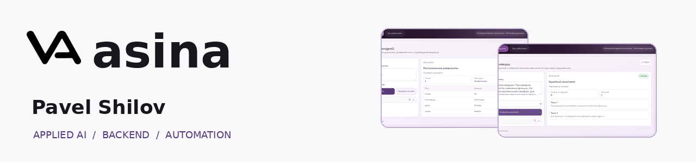
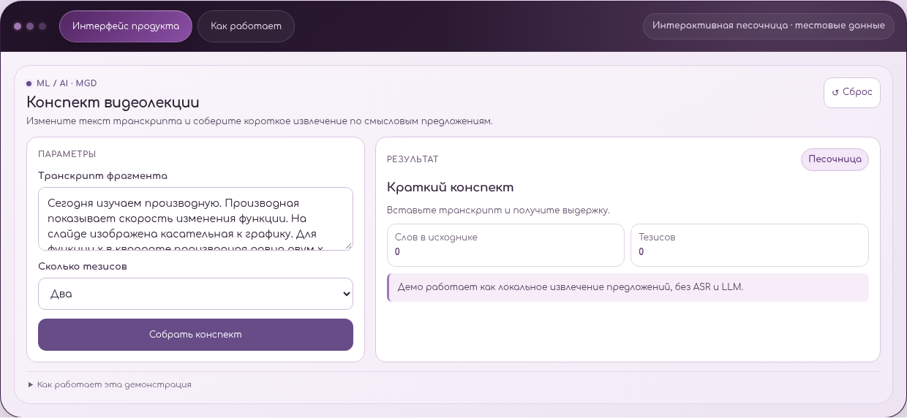
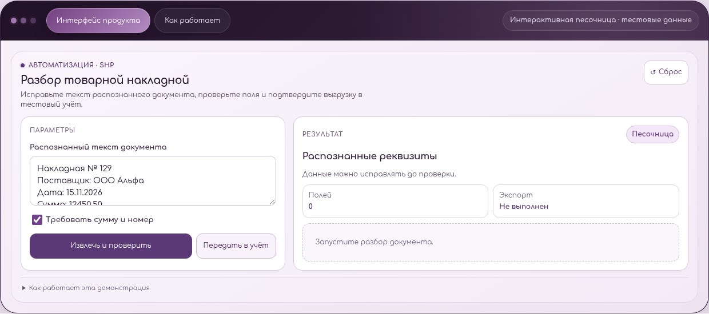
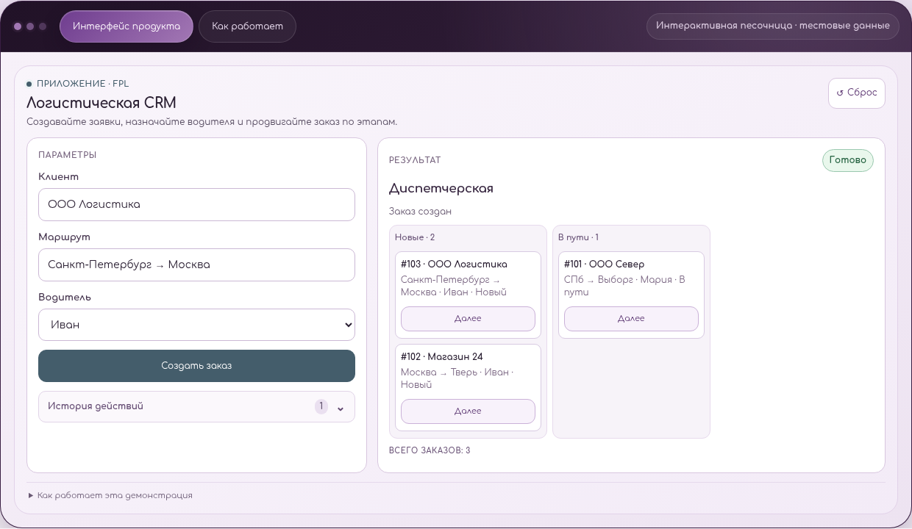
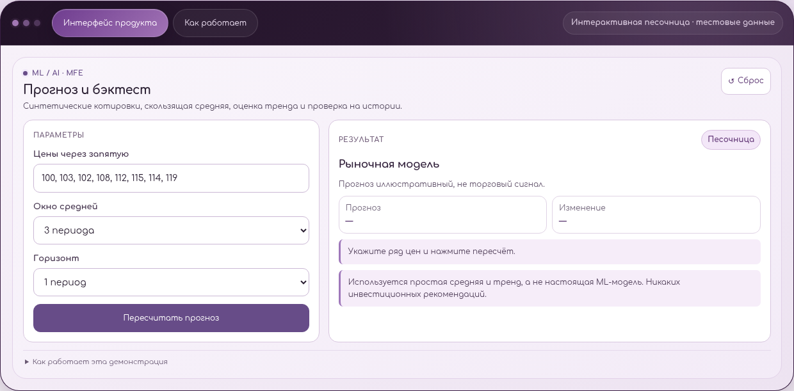
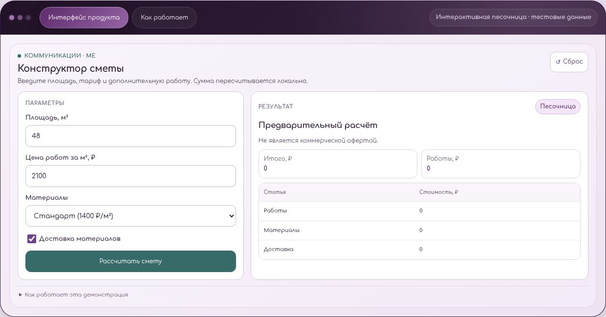

<picture>
  <source media="(max-width: 600px) and (prefers-color-scheme: dark)" srcset="./assets/real-demo-shots/hero-dark-mobile.png">
  <source media="(max-width: 600px) and (prefers-color-scheme: light)" srcset="./assets/real-demo-shots/hero-light-mobile.png">
  <source media="(prefers-color-scheme: dark)" srcset="./assets/real-demo-shots/hero-dark-desktop.png">
  
</picture>

<a href="https://spv-asina.github.io/asina/"><strong>Portfolio</strong></a> &nbsp;&nbsp;·&nbsp;&nbsp; <a href="https://spv-asina.github.io/asina/cases.html">All work</a> &nbsp;&nbsp;·&nbsp;&nbsp; <a href="https://t.me/spv_asina">Telegram</a>

## Selected projects

Five working browser demos across **AI / ML, backend and automation**. Select a screenshot to open the case.

### 01 / [Lecture summarization](https://spv-asina.github.io/asina/case-mgd.html)

**Multimodal AI / Speech** · MGD

Transcription, frame interpretation and structured lecture summaries. The browser sandbox demonstrates extracting key statements from a sample transcript.

<a href="https://spv-asina.github.io/asina/case-mgd.html">
<picture>
  <source media="(max-width: 600px)" srcset="./assets/real-demo-shots/mgd-mobile-focus.png">
  
</picture>
</a>

Python · faster-whisper · OpenCV · RuT5 · [Open the case and interactive demo](https://spv-asina.github.io/asina/case-mgd.html)

### 02 / [Document OCR & validation](https://spv-asina.github.io/asina/case-shp.html)

**Automation / Document processing** · SHP

A document-processing pipeline that extracts and validates invoice fields before transferring structured data into an accounting workflow.

<a href="https://spv-asina.github.io/asina/case-shp.html">
<picture>
  <source media="(max-width: 600px)" srcset="./assets/real-demo-shots/shp-mobile-focus.png">
  
</picture>
</a>

Python · FastAPI · OCR · PostgreSQL · [Open the case and interactive demo](https://spv-asina.github.io/asina/case-shp.html)

### 03 / [Logistics CRM](https://spv-asina.github.io/asina/case-fpl.html)

**Product engineering / Backend** · FPL

A dispatch workflow for customer orders, route planning, drivers and notifications. The demo shows creation and status management of sample orders.

<a href="https://spv-asina.github.io/asina/case-fpl.html">
<picture>
  <source media="(max-width: 600px)" srcset="./assets/real-demo-shots/fpl-mobile-focus.png">
  
</picture>
</a>

Python · PostgreSQL · Telegram API · Frontend · [Open the case and interactive demo](https://spv-asina.github.io/asina/case-fpl.html)

### 04 / [Market forecasting](https://spv-asina.github.io/asina/case-mfe.html)

**ML / Time series** · MFE

Feature generation, price-direction modelling, backtesting and verification. The demo visualizes a simple trend calculation on synthetic prices, not a production ML model.

<a href="https://spv-asina.github.io/asina/case-mfe.html">
<picture>
  <source media="(max-width: 600px)" srcset="./assets/real-demo-shots/mfe-mobile-focus.png">
  
</picture>
</a>

Python · scikit-learn · Flask · Redis · [Open the case and interactive demo](https://spv-asina.github.io/asina/case-mfe.html)

### 05 / [Construction estimate automation](https://spv-asina.github.io/asina/case-me.html)

**Automation / Business tools** · ME

Cost calculation, supplier pricing and estimate reporting through an operational workflow. The demo illustrates the calculation using sample inputs.

<a href="https://spv-asina.github.io/asina/case-me.html">
<picture>
  <source media="(max-width: 600px)" srcset="./assets/real-demo-shots/me-mobile-focus.png">
  
</picture>
</a>

Python · Aiogram · ML · PDF · [Open the case and interactive demo](https://spv-asina.github.io/asina/case-me.html)

The screenshots show simplified interactive demonstrations using sample or synthetic inputs, not private production interfaces or actual production model execution.

<a href="https://spv-asina.github.io/asina/cases.html"><strong>Browse the complete project portfolio</strong></a>

---

## Open source & university

### [RAG — Graph Theory Assistant](https://github.com/spv-asina/RAG)

A textbook-based question-answering and practice application. The retrieval layer uses **TF-IDF and pymorphy3** and returns supporting text fragments. Its quiz trainer covers **57 graph-theory terms** and **five question formats**, with progress-aware selection and answer checking.

The application works **without an LLM**. An optional local **Qwen 2.5 7B / llama.cpp** service improves formulations and distractors, with a fallback when unavailable.

[Source code](https://github.com/spv-asina/RAG) · [CI](https://github.com/spv-asina/RAG/actions/workflows/ci.yml) · [MIT license](https://github.com/spv-asina/RAG/blob/master/LICENSE)

### [TSP — Document Processing & Search](https://spv-asina.github.io/asina/case-tsp.html)

University team project exploring OCR, document processing, FAISS retrieval and API integration.

---

## Engineering toolkit

**Machine learning & data science**  
`Python` · `PyTorch` · `TensorFlow` · `scikit-learn` · `CatBoost` · `XGBoost` · `LightGBM` · `NumPy` · `pandas` · feature engineering · evaluation

**LLM applications & retrieval**  
`RAG` · `FAISS` · `Qwen` · `llama.cpp` · `Hugging Face` · `GigaChat` · TF-IDF · embeddings · retrieval pipelines · prompt engineering

**Vision, speech & documents**  
`OpenCV` · `Whisper` · `RuT5` · `OCR` · `LayoutLMv3` · speech processing · document extraction · multimodal pipelines

**Backend & data**  
`FastAPI` · `Flask` · `SQLAlchemy` · `PostgreSQL` · `Redis` · `MongoDB` · `ClickHouse` · REST APIs · webhooks · SQL · ETL

**Programming & frontend**  
`Python` · `C++` · `JavaScript` · `TypeScript` · `HTML` · `CSS` · `Bash` · `Rust` · `Go` · `Swift` · `Scala`

**Infrastructure & automation**  
`Docker` · `Kubernetes` · `Git` · `GitHub Actions` · `Linux` · `CI/CD` · `pytest` · `Nginx` · `Aiogram` · `Kafka` · monitoring · Telegram APIs

These technologies span professional work, independent development and university coursework. Depth of experience varies.

---

## About & contact

Applied Mathematics and Informatics at Peter the Great St. Petersburg Polytechnic University (SPbPU). I work on digital products from requirements and architecture through implementation, validation and documentation.

**[Discuss a project on Telegram](https://t.me/spv_asina)** · **[Visit the website](https://spv-asina.github.io/asina/)**
