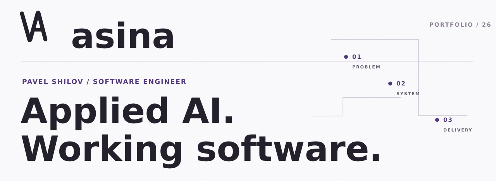
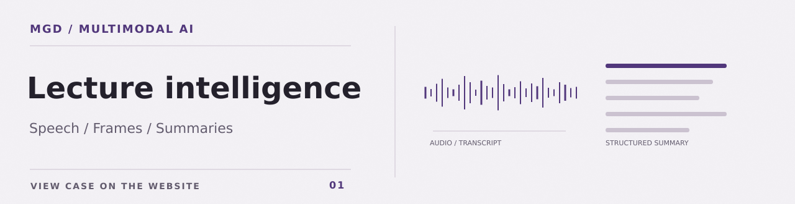
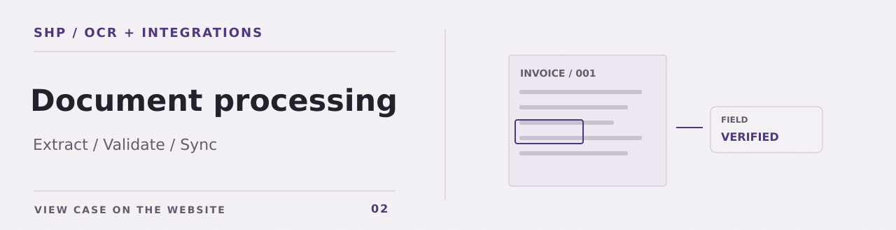
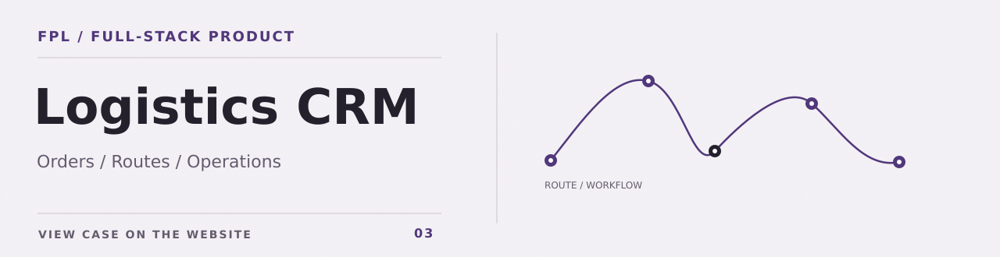
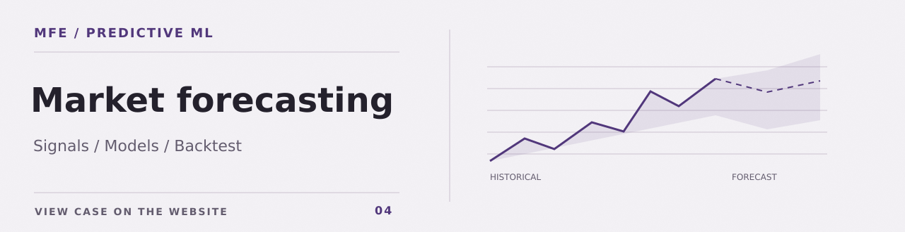
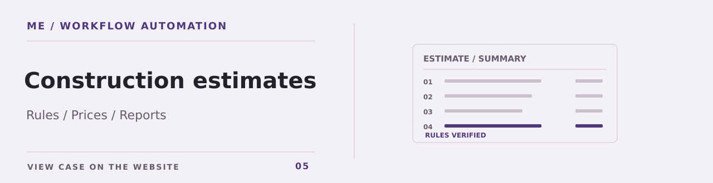
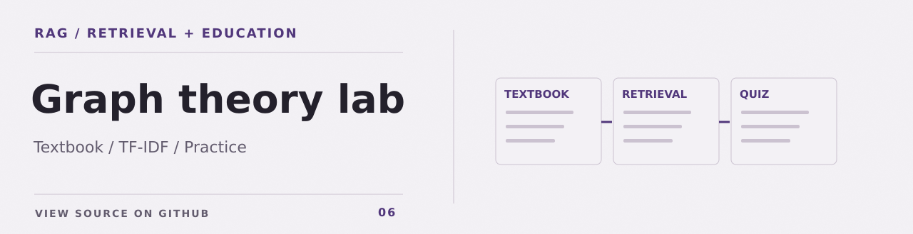

<picture><source media="(max-width: 600px) and (prefers-color-scheme: dark)" srcset="./assets/profile-v4/hero-dark-mobile.svg"><source media="(max-width: 600px) and (prefers-color-scheme: light)" srcset="./assets/profile-v4/hero-light-mobile.svg"><source media="(prefers-color-scheme: dark)" srcset="./assets/profile-v4/hero-dark-desktop.svg"></picture>

<a href="https://spv-asina.github.io/asina/">PORTFOLIO</a> &nbsp; / &nbsp; <a href="https://spv-asina.github.io/asina/cases.html">SELECTED PROJECTS</a> &nbsp; / &nbsp; <a href="https://t.me/spv_asina">CONTACT</a>

### A little about me

I'm a software engineer working at the intersection of **applied machine learning**, **backend systems** and **product development**. I build tools that solve actual operational problems — from document understanding and forecasting to interfaces, integrations and automation.

Applied Mathematics & Informatics — Peter the Great St. Petersburg Polytechnic University.

---

## Selected projects

Five engineering cases. Each cover opens the project page with the workflow, implementation details and interactive material where available.

<a href="https://spv-asina.github.io/asina/case-mgd.html"><picture><source media="(max-width: 600px) and (prefers-color-scheme: dark)" srcset="./assets/profile-v4/case-mgd-dark-mobile.svg"><source media="(max-width: 600px) and (prefers-color-scheme: light)" srcset="./assets/profile-v4/case-mgd-light-mobile.svg"><source media="(prefers-color-scheme: dark)" srcset="./assets/profile-v4/case-mgd-dark-desktop.svg"></picture></a>

<a href="https://spv-asina.github.io/asina/case-shp.html"><picture><source media="(max-width: 600px) and (prefers-color-scheme: dark)" srcset="./assets/profile-v4/case-shp-dark-mobile.svg"><source media="(max-width: 600px) and (prefers-color-scheme: light)" srcset="./assets/profile-v4/case-shp-light-mobile.svg"><source media="(prefers-color-scheme: dark)" srcset="./assets/profile-v4/case-shp-dark-desktop.svg"></picture></a>

<a href="https://spv-asina.github.io/asina/case-fpl.html"><picture><source media="(max-width: 600px) and (prefers-color-scheme: dark)" srcset="./assets/profile-v4/case-fpl-dark-mobile.svg"><source media="(max-width: 600px) and (prefers-color-scheme: light)" srcset="./assets/profile-v4/case-fpl-light-mobile.svg"><source media="(prefers-color-scheme: dark)" srcset="./assets/profile-v4/case-fpl-dark-desktop.svg"></picture></a>

<a href="https://spv-asina.github.io/asina/case-mfe.html"><picture><source media="(max-width: 600px) and (prefers-color-scheme: dark)" srcset="./assets/profile-v4/case-mfe-dark-mobile.svg"><source media="(max-width: 600px) and (prefers-color-scheme: light)" srcset="./assets/profile-v4/case-mfe-light-mobile.svg"><source media="(prefers-color-scheme: dark)" srcset="./assets/profile-v4/case-mfe-dark-desktop.svg"></picture></a>

<a href="https://spv-asina.github.io/asina/case-me.html"><picture><source media="(max-width: 600px) and (prefers-color-scheme: dark)" srcset="./assets/profile-v4/case-me-dark-mobile.svg"><source media="(max-width: 600px) and (prefers-color-scheme: light)" srcset="./assets/profile-v4/case-me-light-mobile.svg"><source media="(prefers-color-scheme: dark)" srcset="./assets/profile-v4/case-me-dark-desktop.svg"></picture></a>

<a href="https://spv-asina.github.io/asina/cases.html"><b>Explore the complete portfolio ↗</b></a>

---

## Open source & learning

<a href="https://github.com/spv-asina/RAG"><picture><source media="(max-width: 600px) and (prefers-color-scheme: dark)" srcset="./assets/profile-v4/case-rag-dark-mobile.svg"><source media="(max-width: 600px) and (prefers-color-scheme: light)" srcset="./assets/profile-v4/case-rag-light-mobile.svg"><source media="(prefers-color-scheme: dark)" srcset="./assets/profile-v4/case-rag-dark-desktop.svg"></picture></a>

**[RAG — Graph Theory Assistant](https://github.com/spv-asina/RAG)** · Full-stack educational retrieval application. **TF-IDF and pymorphy3** search through graph theory textbook material; a quiz trainer tracks progress across **57 terms** and **five question types**. It works without an LLM; **Qwen 2.5 7B** via llama.cpp can optionally refine language and distractors. [Source code](https://github.com/spv-asina/RAG) · [CI](https://github.com/spv-asina/RAG/actions/workflows/ci.yml) · [MIT](https://github.com/spv-asina/RAG/blob/master/LICENSE).

**[TSP — Document Processing & Semantic Search](https://spv-asina.github.io/asina/case-tsp.html)** · OCR, structured document extraction, FAISS retrieval and a backend API; university team course project.

---

## Technical practice

**01 / AI & machine learning**  
Python · PyTorch · TensorFlow · scikit-learn · CatBoost · XGBoost · LightGBM · pandas · NumPy · model evaluation · feature engineering

**02 / LLMs & retrieval**  
RAG · Qwen · llama.cpp · FAISS · embeddings · vector search · TF-IDF · Hugging Face · prompt engineering · GigaChat

**03 / Vision, speech & OCR**  
OpenCV · Whisper · RuT5 · OCR pipelines · document layouts · LayoutLMv3 · multimodal data processing

**04 / Backend & data**  
FastAPI · Flask · Python · SQLAlchemy · PostgreSQL · Redis · MongoDB · ClickHouse · REST APIs · webhooks · JSON · SQL · ETL

**05 / Frontend & languages**  
JavaScript · TypeScript · HTML · CSS · C++ · Bash · React · Vue · Rust · Go · Swift · Scala

**06 / Automation & delivery**  
Docker · Kubernetes · Git · GitHub Actions · Linux · CI/CD · pytest · Nginx · Aiogram · Telegram Bot API · Kafka · monitoring

Tools span practical projects, independent development and university work; depth of experience varies.

---

## Collaboration

I work with new product ideas, difficult technical integrations, ML/AI features and automation of manual processes.

**[Discuss a project on Telegram](https://t.me/spv_asina)** · **[Explore my work](https://spv-asina.github.io/asina/)**
