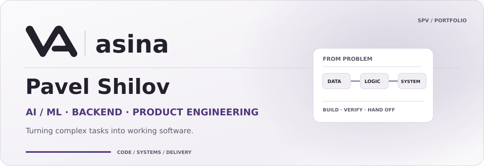
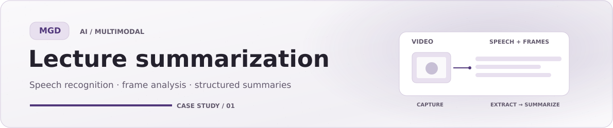
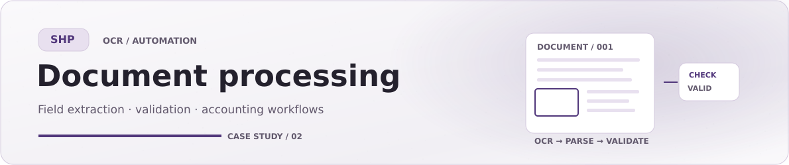
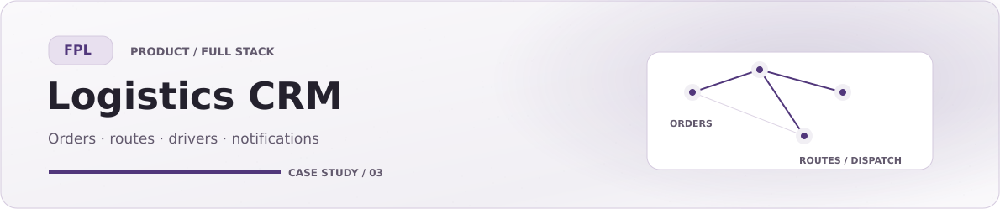
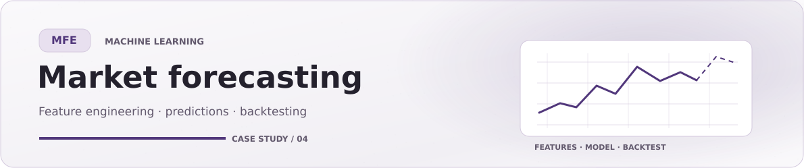
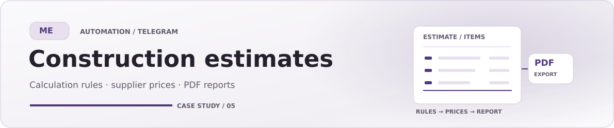
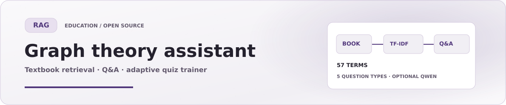

<picture>
  <source media="(prefers-color-scheme: dark)" srcset="./assets/profile-v2/hero-dark.svg">
  <source media="(prefers-color-scheme: light)" srcset="./assets/profile-v2/hero-light.svg">
  
</picture>

<strong>Software Engineer · AI / ML · Backend · Automation</strong>

I turn complex problems into working systems — from data pipelines and intelligent features to production-ready applications.

<a href="https://spv-asina.github.io/asina/"><strong>Portfolio</strong></a> &nbsp;·&nbsp; <a href="https://spv-asina.github.io/asina/cases.html">Case studies</a> &nbsp;·&nbsp; <a href="https://t.me/spv_asina">Telegram</a>

## About

I develop new digital products and improve existing systems. My work spans machine learning, backend services, OCR, data processing, full-stack applications and integrations, with a focus on usable results, maintainable code and documentation.

Applied Mathematics and Informatics at Peter the Great St. Petersburg Polytechnic University (SPbPU).

<picture>
  <source media="(prefers-color-scheme: dark)" srcset="./assets/profile-v2/section-work-dark.svg">
  <source media="(prefers-color-scheme: light)" srcset="./assets/profile-v2/section-work-light.svg">
  
</picture>

<a href="https://spv-asina.github.io/asina/case-mgd.html">
<picture>
  <source media="(prefers-color-scheme: dark)" srcset="./assets/profile-v2/case-mgd-dark.svg">
  <source media="(prefers-color-scheme: light)" srcset="./assets/profile-v2/case-mgd-light.svg">
  
</picture>
</a>

<b>MGD</b> · Python · Whisper · RuT5 · OpenCV · Gradio · <a href="https://spv-asina.github.io/asina/case-mgd.html">Read the case study</a>

<a href="https://spv-asina.github.io/asina/case-shp.html">
<picture>
  <source media="(prefers-color-scheme: dark)" srcset="./assets/profile-v2/case-shp-dark.svg">
  <source media="(prefers-color-scheme: light)" srcset="./assets/profile-v2/case-shp-light.svg">
  
</picture>
</a>

<b>SHP</b> · Python · FastAPI · OCR · PostgreSQL · <a href="https://spv-asina.github.io/asina/case-shp.html">Read the case study</a>

<a href="https://spv-asina.github.io/asina/case-fpl.html">
<picture>
  <source media="(prefers-color-scheme: dark)" srcset="./assets/profile-v2/case-fpl-dark.svg">
  <source media="(prefers-color-scheme: light)" srcset="./assets/profile-v2/case-fpl-light.svg">
  
</picture>
</a>

<b>FPL</b> · Python · PostgreSQL · Telegram API · Frontend · <a href="https://spv-asina.github.io/asina/case-fpl.html">Read the case study</a>

<a href="https://spv-asina.github.io/asina/case-mfe.html">
<picture>
  <source media="(prefers-color-scheme: dark)" srcset="./assets/profile-v2/case-mfe-dark.svg">
  <source media="(prefers-color-scheme: light)" srcset="./assets/profile-v2/case-mfe-light.svg">
  
</picture>
</a>

<b>MFE</b> · Python · Flask · scikit-learn · Redis · <a href="https://spv-asina.github.io/asina/case-mfe.html">Read the case study</a>

<a href="https://spv-asina.github.io/asina/case-me.html">
<picture>
  <source media="(prefers-color-scheme: dark)" srcset="./assets/profile-v2/case-me-dark.svg">
  <source media="(prefers-color-scheme: light)" srcset="./assets/profile-v2/case-me-light.svg">
  
</picture>
</a>

<b>ME</b> · Python · Aiogram · ML · Parsing · <a href="https://spv-asina.github.io/asina/case-me.html">Read the case study</a>

<a href="https://spv-asina.github.io/asina/cases.html"><strong>Explore all projects on my website</strong></a>

<picture>
  <source media="(prefers-color-scheme: dark)" srcset="./assets/profile-v2/section-study-dark.svg">
  <source media="(prefers-color-scheme: light)" srcset="./assets/profile-v2/section-study-light.svg">
  
</picture>

<a href="https://github.com/spv-asina/RAG">
<picture>
  <source media="(prefers-color-scheme: dark)" srcset="./assets/profile-v2/rag-dark.svg">
  <source media="(prefers-color-scheme: light)" srcset="./assets/profile-v2/rag-light.svg">
  
</picture>
</a>

**[RAG — Graph Theory Assistant](https://github.com/spv-asina/RAG)** is an educational retrieval and quiz application, **not an LLM-only chatbot**. It searches a graph-theory textbook using **TF-IDF and pymorphy3-based morphological analysis**, returns sources, and generates practice tests covering **57 terms and five question types**. Progress-aware question selection and answer checking work **without an LLM**. A locally hosted **Qwen 2.5 7B via llama.cpp** can optionally improve phrasing and distractors, with a fallback when unavailable.

[Source and setup](https://github.com/spv-asina/RAG) · [CI](https://github.com/spv-asina/RAG/actions/workflows/ci.yml) · [MIT License](https://github.com/spv-asina/RAG/blob/master/LICENSE)

**[TSP — Document Processing & Semantic Search](https://spv-asina.github.io/asina/case-tsp.html)** — university team project combining OCR, document processing, semantic retrieval and API integration. *Python · FastAPI · Flask · PostgreSQL · FAISS · Docker.*

<picture>
  <source media="(prefers-color-scheme: dark)" srcset="./assets/profile-v2/section-stack-dark.svg">
  <source media="(prefers-color-scheme: light)" srcset="./assets/profile-v2/section-stack-light.svg">
  
</picture>

**Languages & frontend**

<picture>
  <source media="(prefers-color-scheme: dark)" srcset="https://skillicons.dev/icons?i=python,cpp,js,ts,html,css,rust,go,java&amp;theme=dark&amp;perline=9">
  <source media="(prefers-color-scheme: light)" srcset="https://skillicons.dev/icons?i=python,cpp,js,ts,html,css,rust,go,java&amp;theme=light&amp;perline=9">
  
</picture>

Python · C++ · JavaScript · TypeScript · SQL · Bash · HTML · CSS. Also studied: Rust, Go, Swift, Scala and other systems/programming languages.

**Machine learning & data science**

<picture>
  <source media="(prefers-color-scheme: dark)" srcset="https://skillicons.dev/icons?i=pytorch,tensorflow,sklearn,opencv,anaconda&amp;theme=dark&amp;perline=9">
  <source media="(prefers-color-scheme: light)" srcset="https://skillicons.dev/icons?i=pytorch,tensorflow,sklearn,opencv,anaconda&amp;theme=light&amp;perline=9">
  
</picture>

PyTorch · TensorFlow · scikit-learn · CatBoost · XGBoost · LightGBM · NumPy · pandas · feature engineering · model evaluation · computer vision.

**LLMs, retrieval, speech & documents**

RAG · FAISS · TF-IDF · Qwen · llama.cpp · Hugging Face · OCR · LayoutLMv3 · Whisper · RuT5 · GigaChat · embeddings · document parsing.

**Backend, APIs & databases**

<picture>
  <source media="(prefers-color-scheme: dark)" srcset="https://skillicons.dev/icons?i=fastapi,flask,postgres,redis,mongodb,nginx&amp;theme=dark&amp;perline=9">
  <source media="(prefers-color-scheme: light)" srcset="https://skillicons.dev/icons?i=fastapi,flask,postgres,redis,mongodb,nginx&amp;theme=light&amp;perline=9">
  
</picture>

FastAPI · Flask · SQLAlchemy · PostgreSQL · Redis · MongoDB · ClickHouse · REST API · webhooks · service integration.

**Automation, messaging & data pipelines**

Aiogram · Telegram Bot API · ETL · parsing · scheduled tasks · Kafka · event-driven workflows · notification services · file-processing pipelines.

**Infrastructure & quality**

<picture>
  <source media="(prefers-color-scheme: dark)" srcset="https://skillicons.dev/icons?i=docker,kubernetes,git,github,linux,grafana&amp;theme=dark&amp;perline=9">
  <source media="(prefers-color-scheme: light)" srcset="https://skillicons.dev/icons?i=docker,kubernetes,git,github,linux,grafana&amp;theme=light&amp;perline=9">
  
</picture>

Docker · Kubernetes · Git · GitHub Actions · Linux · CI/CD · Nginx · observability · testing · pytest.

Toolkit represents technologies appearing across engineering projects and coursework; not every tool has equal production depth.

<picture>
  <source media="(prefers-color-scheme: dark)" srcset="./assets/profile-v2/section-activity-dark.svg">
  <source media="(prefers-color-scheme: light)" srcset="./assets/profile-v2/section-activity-light.svg">
  
</picture>

<picture>
  <source media="(prefers-color-scheme: dark)" srcset="https://github-readme-stats.vercel.app/api/top-langs/?username=spv-asina&amp;layout=compact&amp;hide_border=true&amp;bg_color=0B0C12&amp;title_color=A78BDA&amp;text_color=F1EFF4">
  <source media="(prefers-color-scheme: light)" srcset="https://github-readme-stats.vercel.app/api/top-langs/?username=spv-asina&amp;layout=compact&amp;hide_border=true&amp;bg_color=FAF9FB&amp;title_color=51377B&amp;text_color=24212D">
  
</picture>

Language stats are generated by an external GitHub README service and may be unavailable if its rate limit is reached.

<picture>
  <source media="(prefers-color-scheme: dark)" srcset="./assets/profile-v2/section-contact-dark.svg">
  <source media="(prefers-color-scheme: light)" srcset="./assets/profile-v2/section-contact-light.svg">
  
</picture>

Interested in a project, an integration or a technically difficult problem?

**[Telegram · @spv_asina](https://t.me/spv_asina)** &nbsp;·&nbsp; **[Portfolio](https://spv-asina.github.io/asina/)** &nbsp;·&nbsp; **[All case studies](https://spv-asina.github.io/asina/cases.html)**
