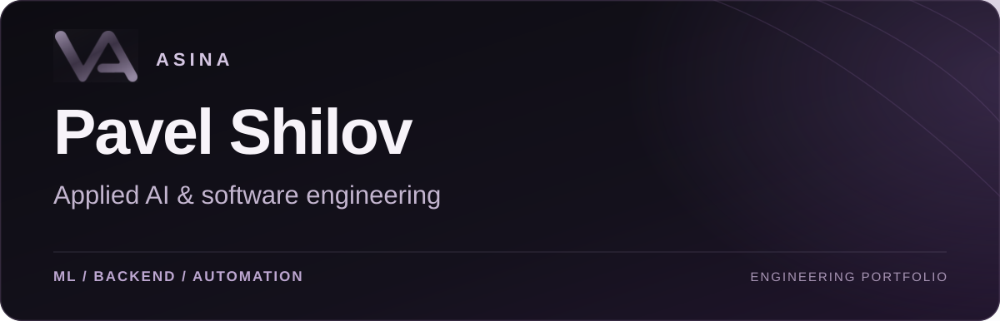
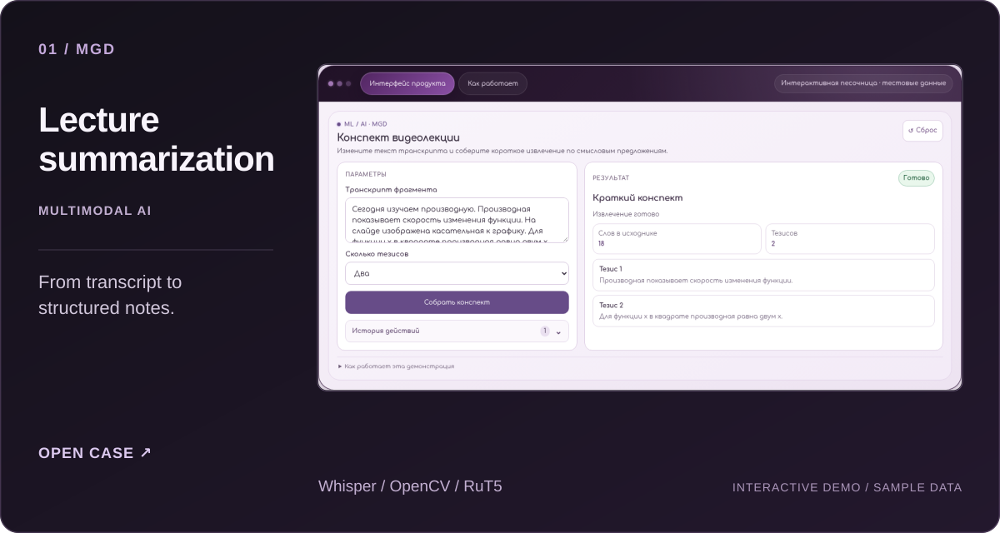
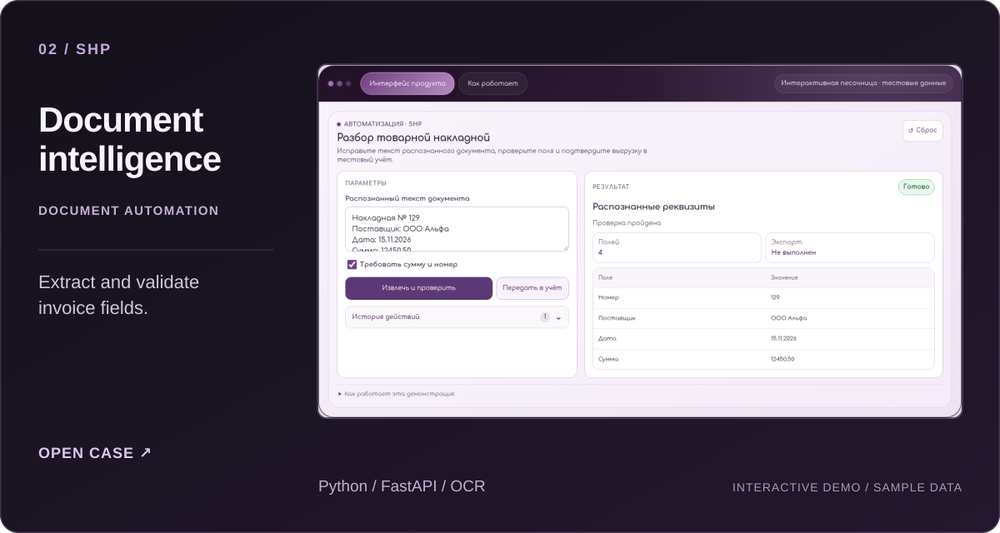
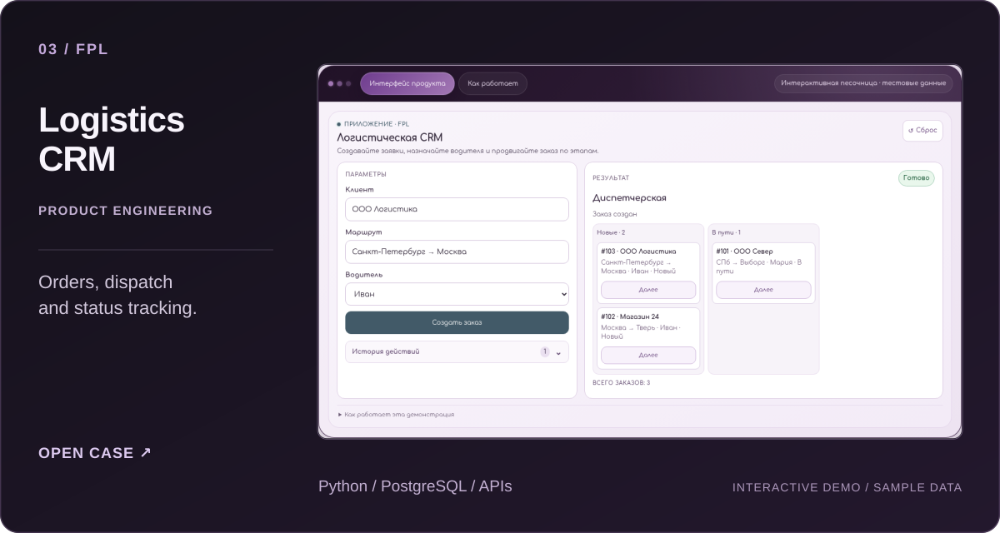
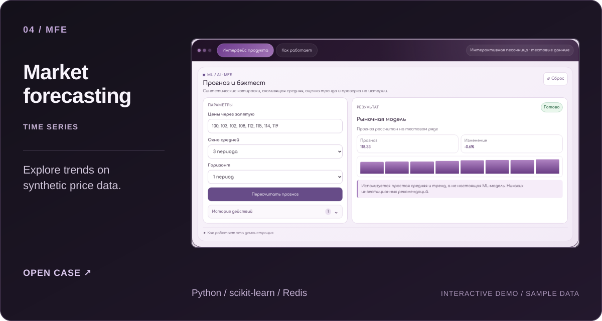
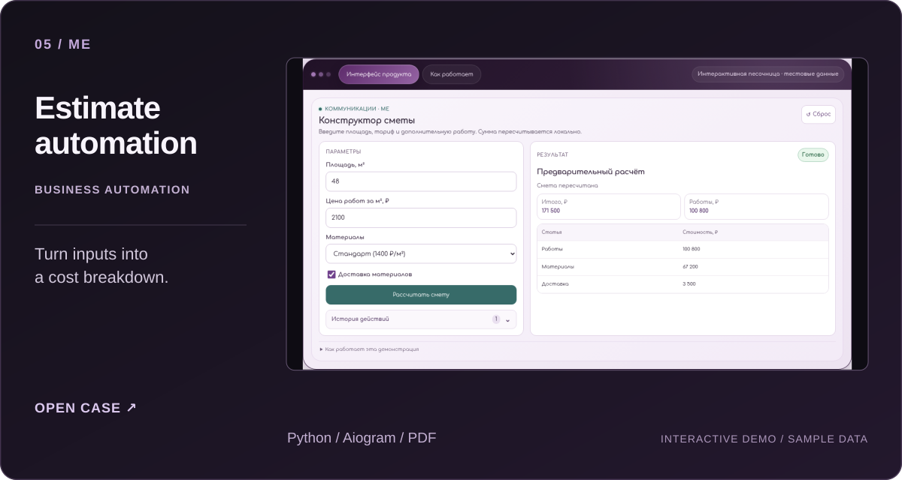

<picture>
  <source media="(max-width: 600px)" srcset="./assets/editorial/hero-mobile.svg">
  
</picture>

**[Portfolio](https://spv-asina.github.io/asina/) · [All projects](https://spv-asina.github.io/asina/cases.html) · [Telegram](https://t.me/spv_asina)**

I build applied ML systems, backend services and automation tools — from data processing and architecture to working interfaces and validation.

## Selected work

Five interactive projects. Each panel contains a genuine screenshot of its public browser demonstration. Open a case to try it.

<a href="https://spv-asina.github.io/asina/case-mgd.html">
<picture>
  <source media="(max-width: 600px)" srcset="./assets/editorial/mgd-mobile.svg">
  
</picture>
</a>

[Lecture summarization — project and interactive demo](https://spv-asina.github.io/asina/case-mgd.html)

<a href="https://spv-asina.github.io/asina/case-shp.html">
<picture>
  <source media="(max-width: 600px)" srcset="./assets/editorial/shp-mobile.svg">
  
</picture>
</a>

[Document intelligence — project and interactive demo](https://spv-asina.github.io/asina/case-shp.html)

<a href="https://spv-asina.github.io/asina/case-fpl.html">
<picture>
  <source media="(max-width: 600px)" srcset="./assets/editorial/fpl-mobile.svg">
  
</picture>
</a>

[Logistics CRM — project and interactive demo](https://spv-asina.github.io/asina/case-fpl.html)

<a href="https://spv-asina.github.io/asina/case-mfe.html">
<picture>
  <source media="(max-width: 600px)" srcset="./assets/editorial/mfe-mobile.svg">
  
</picture>
</a>

[Market forecasting — project and interactive demo](https://spv-asina.github.io/asina/case-mfe.html)

<a href="https://spv-asina.github.io/asina/case-me.html">
<picture>
  <source media="(max-width: 600px)" srcset="./assets/editorial/me-mobile.svg">
  
</picture>
</a>

[Estimate automation — project and interactive demo](https://spv-asina.github.io/asina/case-me.html)

Demonstrations use sample or synthetic data. They are simplified browser sandboxes, not private production interfaces or evidence of production model inference.

**[Explore the full portfolio](https://spv-asina.github.io/asina/cases.html)**

## Open source

**[RAG — Graph Theory Assistant](https://github.com/spv-asina/RAG)**

Textbook question answering using TF-IDF and pymorphy3 with supporting fragments; practice on 57 terms across five question types. Optional local Qwen 2.5 7B via llama.cpp, with a non-LLM fallback.

[Repository](https://github.com/spv-asina/RAG) · [CI](https://github.com/spv-asina/RAG/actions/workflows/ci.yml) · [MIT](https://github.com/spv-asina/RAG/blob/master/LICENSE)

**[TSP — Document Processing & Search](https://spv-asina.github.io/asina/case-tsp.html)**

University team project: OCR, document processing, FAISS retrieval and API integration.

## Engineering toolkit

**Machine learning & data science**  
`Python` · `PyTorch` · `TensorFlow` · `scikit-learn` · `CatBoost` · `XGBoost` · `LightGBM` · `NumPy` · `pandas` · feature engineering · evaluation

**LLM applications & retrieval**  
`RAG` · `FAISS` · `Qwen` · `llama.cpp` · `Hugging Face` · `GigaChat` · TF-IDF · embeddings · retrieval pipelines · prompt engineering

**Vision, speech & documents**  
`OpenCV` · `Whisper` · `RuT5` · `OCR` · `LayoutLMv3` · speech processing · document extraction · multimodal pipelines

**Backend & data**  
`FastAPI` · `Flask` · `SQLAlchemy` · `PostgreSQL` · `Redis` · `MongoDB` · `ClickHouse` · REST APIs · webhooks · SQL · ETL

**Programming & frontend**  
`Python` · `C++` · `JavaScript` · `TypeScript` · `HTML` · `CSS` · `Bash` · `Rust` · `Go` · `Swift` · `Scala`

**Infrastructure & automation**  
`Docker` · `Kubernetes` · `Git` · `GitHub Actions` · `Linux` · `CI/CD` · `pytest` · `Nginx` · `Aiogram` · `Kafka` · monitoring · Telegram APIs

These technologies span professional work, independent development and university coursework. Depth of experience varies.

---

## About & contact

Applied Mathematics and Informatics at Peter the Great St. Petersburg Polytechnic University (SPbPU). I work on digital products from requirements and architecture through implementation, validation and documentation.

**[Discuss a project on Telegram](https://t.me/spv_asina)** · **[Visit the website](https://spv-asina.github.io/asina/)**
