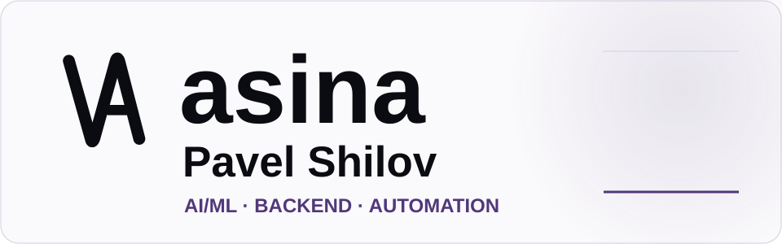
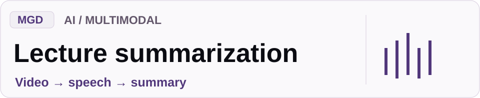
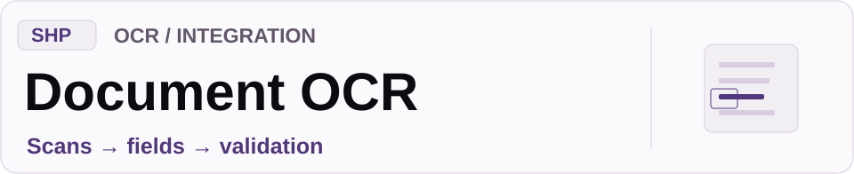
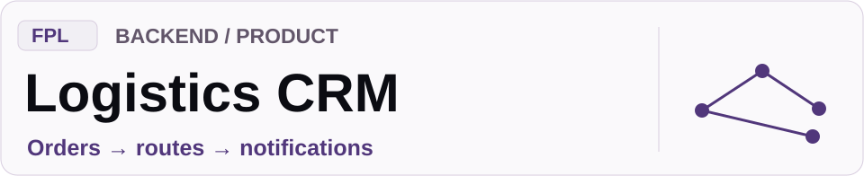
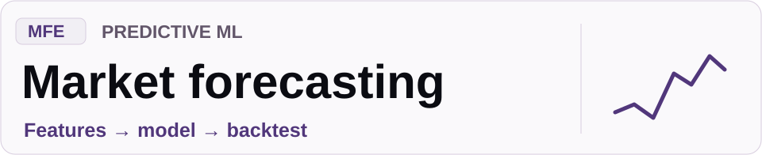
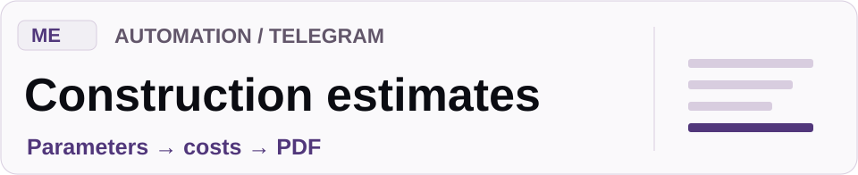
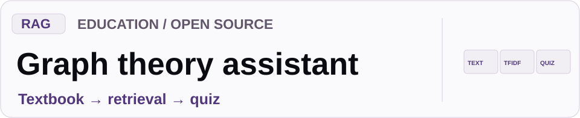

<picture>
  <source media="(prefers-color-scheme: dark)" srcset="./assets/profile-v3/hero-dark.svg">
  <source media="(prefers-color-scheme: light)" srcset="./assets/profile-v3/hero-light.svg">
  
</picture>

I develop intelligent products, backend systems and automation — from the initial problem to a working application.

 &nbsp;  &nbsp; 

## Selected work

Five representative projects across ML, document processing, product engineering and automation. Each card opens a detailed case study on my website.

<a href="https://spv-asina.github.io/asina/case-mgd.html">
<picture>
  <source media="(prefers-color-scheme: dark)" srcset="./assets/profile-v3/case-mgd-dark.svg">
  <source media="(prefers-color-scheme: light)" srcset="./assets/profile-v3/case-mgd-light.svg">
  
</picture>
</a>

<a href="https://spv-asina.github.io/asina/case-shp.html">
<picture>
  <source media="(prefers-color-scheme: dark)" srcset="./assets/profile-v3/case-shp-dark.svg">
  <source media="(prefers-color-scheme: light)" srcset="./assets/profile-v3/case-shp-light.svg">
  
</picture>
</a>

<a href="https://spv-asina.github.io/asina/case-fpl.html">
<picture>
  <source media="(prefers-color-scheme: dark)" srcset="./assets/profile-v3/case-fpl-dark.svg">
  <source media="(prefers-color-scheme: light)" srcset="./assets/profile-v3/case-fpl-light.svg">
  
</picture>
</a>

<a href="https://spv-asina.github.io/asina/case-mfe.html">
<picture>
  <source media="(prefers-color-scheme: dark)" srcset="./assets/profile-v3/case-mfe-dark.svg">
  <source media="(prefers-color-scheme: light)" srcset="./assets/profile-v3/case-mfe-light.svg">
  
</picture>
</a>

<a href="https://spv-asina.github.io/asina/case-me.html">
<picture>
  <source media="(prefers-color-scheme: dark)" srcset="./assets/profile-v3/case-me-dark.svg">
  <source media="(prefers-color-scheme: light)" srcset="./assets/profile-v3/case-me-light.svg">
  
</picture>
</a>

<a href="https://spv-asina.github.io/asina/cases.html"><strong>Browse the full portfolio</strong></a>

## Open source & university

<a href="https://github.com/spv-asina/RAG">
<picture>
  <source media="(prefers-color-scheme: dark)" srcset="./assets/profile-v3/case-rag-dark.svg">
  <source media="(prefers-color-scheme: light)" srcset="./assets/profile-v3/case-rag-light.svg">
  
</picture>
</a>

**[RAG — Graph Theory Assistant](https://github.com/spv-asina/RAG)** is an educational search-and-practice application built around a graph theory textbook. It retrieves source-backed answers using **TF-IDF and pymorphy3**, and includes an adaptive quiz trainer for **57 terms** and **five question types**. It works without a language model; **Qwen 2.5 via llama.cpp** is an optional enhancement for question phrasing and distractors. [Source code](https://github.com/spv-asina/RAG) · [CI](https://github.com/spv-asina/RAG/actions/workflows/ci.yml) · [MIT](https://github.com/spv-asina/RAG/blob/master/LICENSE).

**[TSP — Document Search](https://spv-asina.github.io/asina/case-tsp.html)** — university team project: OCR, text processing, semantic retrieval and an API layer with Python, FastAPI, PostgreSQL and FAISS.

## Engineering toolkit

**Languages & web**

**Machine learning & computer vision**

CatBoost · XGBoost · LightGBM · feature engineering · model evaluation

**LLMs, speech & document intelligence**

RAG · TF-IDF · FAISS · Qwen · llama.cpp · Whisper · RuT5 · OCR · LayoutLMv3 · Hugging Face · GigaChat · embeddings

**Backend, APIs & databases**

SQLAlchemy · ClickHouse · REST APIs · webhooks · API integration · ETL

**Infrastructure, automation & quality**

GitHub Actions · CI/CD · Aiogram · Telegram Bot API · message queues · data pipelines · monitoring

Experience varies by technology and project; the stack includes professional work, independent projects and coursework. Technology logos by <a href="https://github.com/devicons/devicon">Devicon</a>.

## Contact

Available to discuss AI/ML, backend engineering, automation and full product development.

 &nbsp;  &nbsp; 

Visual identity: the approved VA monogram, Comfortaa-inspired typography and the Obsidian / Amethyst palette.
